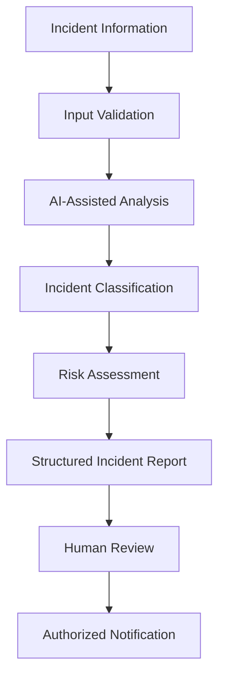
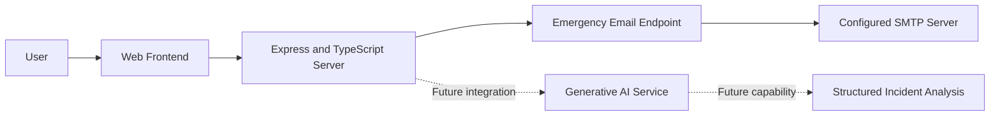

# 🌆 UrbanPulse AI — Urban Intelligence Platform

**AI-assisted urban incident reporting and emergency communication**

UrbanPulse AI is a web application project exploring how artificial intelligence and modern web technologies can support urban incident reporting, contextual analysis, and emergency communication.

The project aims to provide a foundation for organizing urban incident information and exploring AI-assisted workflows for public safety and urban monitoring.

> **Project status:** Prototype / In Development  
> AI inference, multi-agent orchestration, and other planned capabilities should be considered experimental until their implementations are verified.

---

## 📌 Table of Contents

- [Overview](#-overview)
- [Problem Statement](#-problem-statement)
- [Project Objectives](#-project-objectives)
- [Features](#-features)
- [AI Model and Multi-Agent Concept](#-ai-model-and-multi-agent-concept)
- [System Architecture](#-system-architecture)
- [Technology Stack](#-technology-stack)
- [Project Structure](#-project-structure)
- [Getting Started](#-getting-started)
- [Environment Configuration](#-environment-configuration)
- [API Documentation](#-api-documentation)
- [Security and Limitations](#-security-and-limitations)
- [Future Enhancements](#-future-enhancements)
- [Author](#-author)
- [License](#-license)

## 🌍 Overview

UrbanPulse AI explores the use of AI-assisted software to improve the way urban incidents are described, analyzed, and communicated.

The project combines a web application development stack with a TypeScript-based Express server, a generative AI SDK dependency, and email communication functionality.

Its long-term vision is to support a modular urban-intelligence platform that could incorporate incident classification, contextual information, location-aware reporting, and structured emergency notifications.

## 🎯 Problem Statement

Urban incidents such as road hazards, damaged infrastructure, and other public-safety concerns require clear reporting and timely communication.

Manual reporting can make it difficult to organize incident information consistently and communicate relevant details efficiently.

UrbanPulse AI explores how web technologies and AI-assisted analysis could help structure incident reports and support more organized communication.

## 🎯 Project Objectives

- Develop a web-based platform for urban incident reporting.
- Explore generative AI integration for interpreting incident information.
- Provide a backend endpoint for emergency-related email notifications.
- Design a modular foundation for future intelligent analysis components.
- Improve the organization and communication of incident details.
- Establish a foundation for future location-aware urban monitoring features.

## ✨ Features

The project currently exposes the following implementation and development goals.

| Feature | Description | Status |
|---|---|---|
| Web application foundation | Vite-based frontend tooling and React dependencies | Configuration present; complete frontend source needs verification |
| Express server | TypeScript server with Express | Implemented in visible server source |
| Generative AI integration | Google GenAI SDK dependency | Dependency present; active inference workflow not verified |
| Emergency email API | Send emergency-related reports through SMTP | Route implemented; requires SMTP configuration |
| Location-aware reporting | Associate incidents with location information | Planned / requires implementation verification |
| AI incident classification | Categorize urban hazards using AI | Proposed enhancement |
| Multi-agent intelligence | Separate analysis and reporting responsibilities into modules | Proposed architecture |
| Incident dashboard | View and manage reported incidents | Requires implementation verification |

## 🧠 AI Model and Multi-Agent Concept

### Current AI integration

The project includes the `@google/genai` package, which provides access to Google's generative AI services when configured with valid credentials.

However, the presence of this dependency alone does not confirm that a particular model is being called or that an AI classification pipeline is operational.

The specific model identifier, input format, prompt design, output schema, and evaluation results should be documented after the inference implementation is verified.

This project should not be described as a custom-trained machine-learning model unless model-training code and supporting artifacts are actually provided.

### Proposed multi-agent architecture

The following design illustrates a possible future architecture.

| Component | Intended responsibility |
|---|---|
| Input Processing Module | Validate and organize incident descriptions and supporting evidence |
| Incident Analysis Module | Interpret available incident information using a configured AI model |
| Classification Module | Assign an incident category based on defined criteria |
| Risk Assessment Module | Produce an advisory risk assessment using documented rules |
| Location Module | Associate an incident with verified location information |
| Notification Module | Send authorized incident notifications |
| Coordination Module | Combine module outputs into a structured report |

These are proposed logical modules, not claims that independent AI agents already exist in the repository.

### Proposed AI workflow



Each stage would require implementation, testing, and appropriate validation before the workflow could be considered operational.

### Model evaluation

Future model evaluation should consider:

- Classification precision, recall, and F1-score.
- False-positive and false-negative rates.
- Reliability across different incident categories.
- Response latency and API availability.
- Uncertainty handling and human-review requirements.

No model accuracy or benchmark figures are claimed in this README.

## 🏗️ System Architecture

The visible implementation provides an Express server with Vite development middleware and an SMTP email route. The following diagram separates that existing foundation from the proposed AI integration.



### Architecture responsibilities

- **Frontend:** User interface and incident-reporting interactions, subject to the completed frontend implementation.
- **Express backend:** HTTP request handling and server-side operations.
- **Google GenAI SDK:** Dependency available for future or existing AI integration, which must be verified in the application source.
- **Nodemailer:** SMTP-based email delivery.
- **Environment configuration:** Supplies server-side credentials and settings.

A database, persistent incident history, and trained-model storage are not documented as existing capabilities in the visible root files.

## 🛠️ Technology Stack

| Category | Technology |
|---|---|
| Frontend framework | React 19 |
| Frontend development server and bundler | Vite |
| Programming language | TypeScript |
| Backend framework | Express.js |
| AI integration dependency | Google GenAI SDK |
| Email delivery | Nodemailer |
| Styling | Tailwind CSS 4 |
| Icons | Lucide React |
| Animation | Motion |
| Configuration | dotenv |
| Package management | npm |

This list reflects the technologies declared in the package configuration. Actual usage and feature completeness may vary.

## 📂 Project Structure

The repository's visible files include the package configuration, server, HTML entry point, Vite configuration, TypeScript configuration, environment example, metadata, and project presentation.

The following is the intended conventional structure after correcting filenames and ensuring the application source is present.

```text
Urban-pulse-AI/
├── public/
│   └── assets/
├── src/
│   ├── main.tsx
│   ├── App.tsx
│   ├── components/
│   ├── services/
│   └── styles/
├── server.ts
├── index.html
├── package.json
├── package-lock.json
├── tsconfig.json
├── vite.config.ts
├── metadata.json
├── .env.example
├── .gitignore
└── README.md
```

**Note:** This is the target structure, not a verified listing of all files currently present in the repository. Add or document only directories and files that actually exist.

## ⚙️ Getting Started

### Prerequisites

- Node.js compatible with the installed dependencies.
- npm.
- Git.
- SMTP credentials if using the email notification endpoint.
- A Google GenAI API key only if the AI integration is implemented and enabled.

### 1. Clone the repository

```bash
git clone https://github.com/SACHIN-BS07/Urban-pulse-AI.git
cd Urban-pulse-AI
```

### 2. Correct the filenames

Ensure these files have their conventional names:

```text
package.json
package-lock.json
server.ts
index.html
tsconfig.json
vite.config.ts
.env.example
README.md
```

If the existing files include `[1]` suffixes, rename them carefully and resolve any conflicts.

The HTML entry point references `/src/main.tsx`. Confirm that this file and its imported application components exist before starting the app.

### 3. Install dependencies

```bash
npm install
```

Once the package and lock files are correctly named and synchronized, use the following for reproducible installs:

```bash
npm ci
```

### 4. Configure environment variables

Create a local `.env` file in the repository root. Add only the settings required by the functionality you are using.

For email notifications, configure:

```dotenv
SMTP_HOST=smtp.gmail.com
SMTP_PORT=587
SMTP_USER=your-email@example.com
SMTP_PASS=your-email-app-password
EMERGENCY_EMAIL_RECIPIENT=authorized-recipient@example.com
```

If the AI integration is implemented, add the appropriate Google GenAI API key variable expected by its actual source code.

Never commit real API keys, email passwords, or other secrets to GitHub.

### 5. Run the development server

The package configuration defines a development command that executes `tsx server.ts`.

```bash
npm run dev
```

When the filenames and application entry point are correct and all required configuration is available, the server is configured to listen on port `3000`.

Open:

```text
http://localhost:3000
```

If startup fails, check the terminal output, filename consistency, frontend entry point, installed dependencies, and environment variables.

## 🔌 API Documentation

### Send an emergency email

**Endpoint:** `POST /api/send-emergency-email`

**Purpose:** Send an emergency-related email through the configured SMTP transport.

Example request:

```json
{
  "location": "Example location",
  "description": "Urban incident requiring review",
  "severity": "high"
}
```

The visible route requires the following fields:

- `location`
- `description`
- `severity`

It also accepts optional `recipient`, `numberPlate`, and `reporterName` fields.

Example success response:

```json
{
  "success": true,
  "message": "Emergency email sent successfully."
}
```

A successful response is returned after the email transport operation completes. Missing required fields produce a `400` response, while delivery or configuration errors may produce a `500` response.

